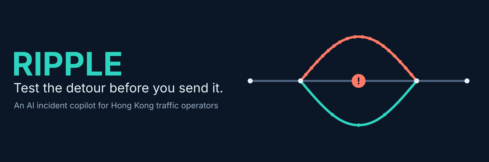
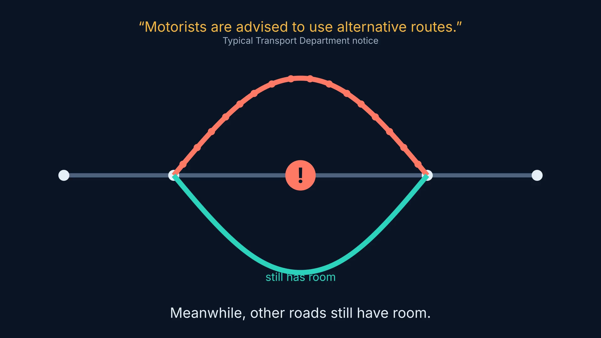
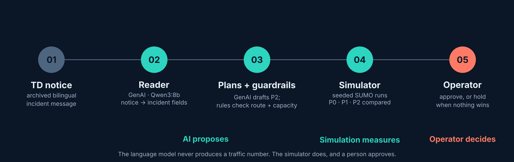
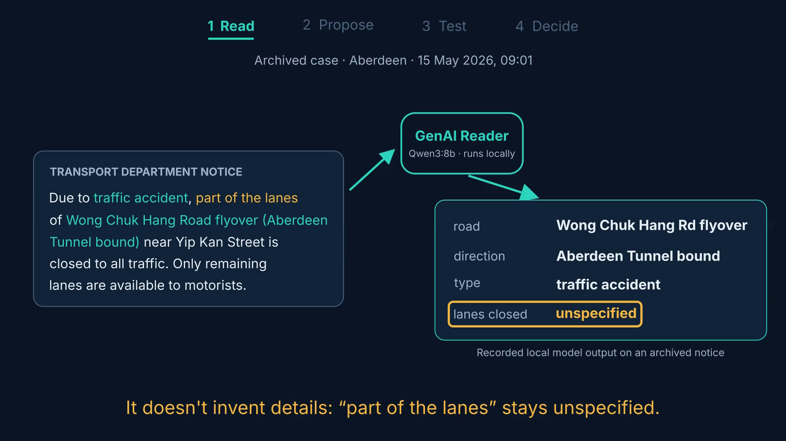
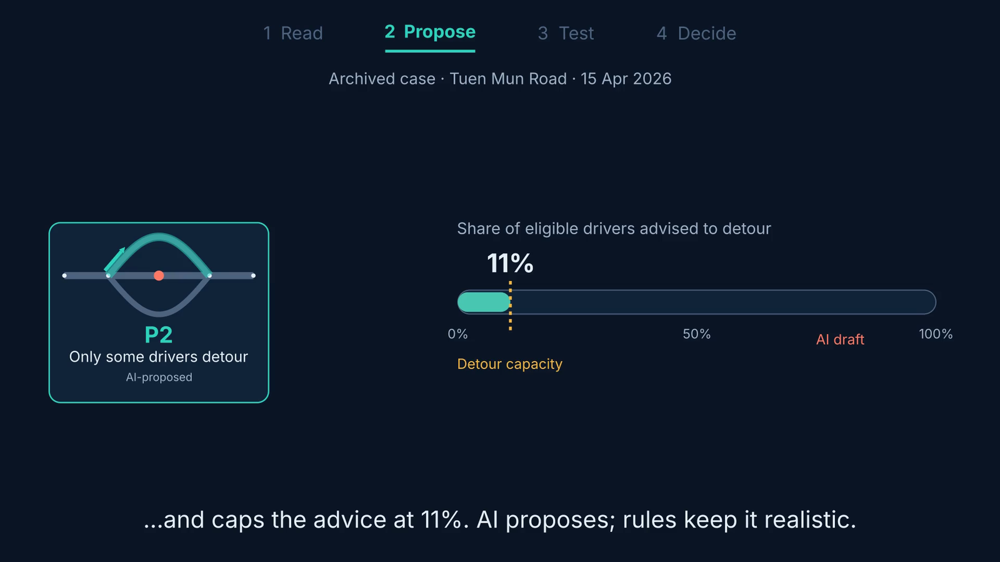
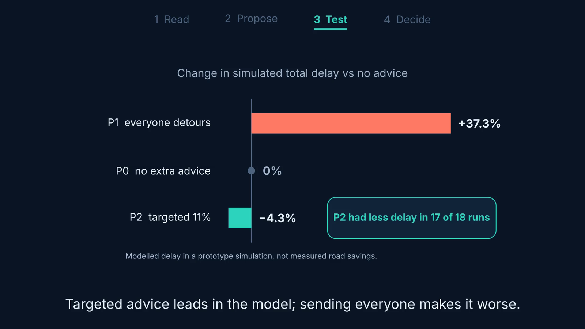
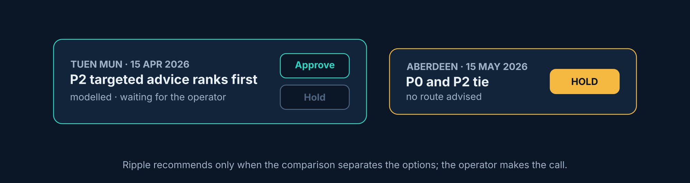
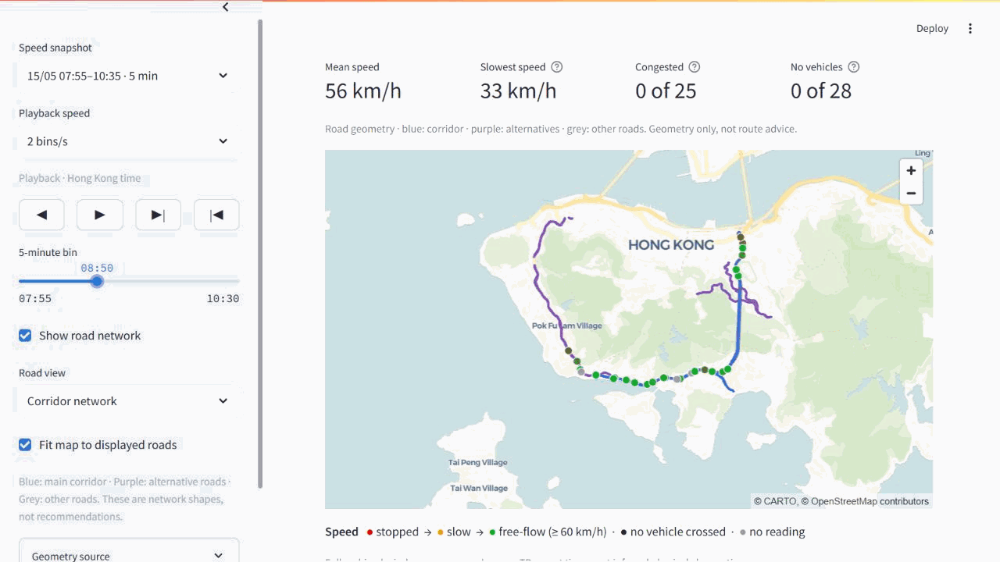

<p align="center">
  
</p>

**Ripple** is an AI incident copilot for Hong Kong traffic operators. When a
crash blocks a road, Ripple reads the Transport Department's incident notice,
drafts a few response options, tests them in a road-network simulation, and
recommends one only when the evidence separates them. A human operator makes
the final call.

Built for the Hong Kong Inter-University GenAI Hackathon for the SDGs 2026
(Hack4SDG), **Track 1: Green Transport & Smart Mobility**.

> [!NOTE]
> Ripple is a research prototype. It replays **archived** incidents from open
> government data. It does not control real roads, signs or signals, and the
> results below are simulated comparisons, not measured road savings.

---

## The problem

When a key road is blocked, everyone tends to get the same advice: *“use
alternative routes.”* If every driver takes the same detour, the jam simply
moves to the next road, while other roads still have room. Navigation apps
optimise each trip; an operator has to protect the whole corridor, quickly and
with a message they can defend.

<p align="center"></p>

## How it works

<p align="center"></p>

| Step | What happens | Where in the code |
|---|---|---|
| **Read** | A local Qwen3:8b model turns the free-text TD notice into structured incident fields. Replies are schema-checked; unknown details stay `unspecified` instead of being guessed. | [`src/reader/`](src/reader/) |
| **Propose** | A second GenAI stage drafts a targeted plan (P2). It is compared with two fixed baselines: no extra advice (P0) and everyone detours (P1). Deterministic checks bound routes and capacity. | [`src/plans/`](src/plans/) |
| **Test** | Seeded SUMO simulations replay every plan across many conditions and write every metric to [`results/`](results/). | [`src/twin/`](src/twin/), [`src/evaluator/`](src/evaluator/) |
| **Decide** | A Streamlit console shows the incident, the comparison and the verdict. The operator approves, or Ripple holds when no option clearly wins. | [`src/console/`](src/console/) |
| **Brief** | A third GenAI stage drafts an operator briefing and bilingual sign text; every number in it must trace back to `results/`. | [`src/briefing/`](src/briefing/) |

**The language model never produces a traffic number.** It reads messages,
drafts candidate plans and writes explanations; the simulator computes the
metrics, and a person approves.

## What the prototype shows

### 1 · The Reader turns a notice into incident data

<p align="center"></p>

On an archived Aberdeen notice (15 May 2026), the saved Qwen3:8b output
identifies the road, direction and incident type, and keeps the lane count
`unspecified` because the source only says “part of the lanes”. The input,
output and model call log are kept in [`evidence/demo/`](evidence/demo/README.md)
and [`evidence/ai-log/`](evidence/ai-log/). Reader accuracy on 100 hand-labelled
messages is reported in
[`data/labelled_incidents/LABELLING.md`](data/labelled_incidents/LABELLING.md#score-history).

### 2 · Tuen Mun Road, 15 Apr 2026: targeted advice leads in the model

<p align="center"></p>
<p align="center"></p>

The AI drafted diverting 80% of eligible drivers; a deterministic capacity rule
capped it at **11%** before any run. Across 18 scored simulated conditions, the
targeted plan P2 had **4.3% less total delay** than no extra advice (paired 95%
interval 3.0–5.6%) and was lower in 17 of 18, while sending everyone (P1) added
about 37%.

*Limitation:* the replayed queue moves too fast (about 42 km/h against about
21 km/h observed) and clears early, so this is a labelled modelled comparison,
not a measured road saving. See the
[Simulation final call](docs/tuen-mun-simulation-final-call-2026-10-15.md) and
the [two-incident pack](docs/demo-two-incidents-2026-10-16.md).

### 3 · Aberdeen, 15 May 2026: the options tie, so Ripple holds

Across 30 scored simulated conditions, no extra advice (P0) and the targeted
plan (P2) tie under the team's ranking rule, and P1 trails. Ripple **withholds a
recommendation** rather than forcing a winner. This saved result is a
diagnostic: some original simulation inputs it references are not in the
repository, so it is not fully reproducible from here.

<p align="center"></p>

### 4 · The operator console

<p align="center"></p>

The console replays archived five-minute detector readings and the published
TD messages on the corridor map. Coloured roads are network geometry, not route
advice. Details: [observed-playback guide](docs/console-observed-playback.md)
and [operator workflow](src/console/OPERATOR_WORKFLOW.md).

Frozen two-case outputs (plans, runs, provenance, rankings and console verdicts)
are in [`results/demo-oct16/`](results/demo-oct16/).

---

## Repository map

| Folder | What's inside |
|---|---|
| [`src/`](src/README.md) | The pipeline, one package per component (A–G) |
| [`docs/`](docs/README.md) | Brief, data guide, architecture contracts, plan, pitch, and the dated working notes |
| [`results/`](results/README.md) | Every number Ripple presents: Reader scores, simulation runs, rankings, the frozen demo pack |
| [`data/`](data/README.md) | Corridor tables, labelled incidents, archived demo messages, generated plans and briefings |
| [`sim/`](sim/README.md) | SUMO networks and scenario files for Aberdeen and Tuen Mun |
| [`evidence/`](evidence/README.md) | Model call logs, the recorded Reader demo page, user interview notes |
| [`deck/`](deck/README.md) | Pitch sources: slide drafts, Q&A sheet, costing notes, submission manifest |
| [`scripts/`](scripts/README.md) | One-off builders for the demo pack, result cards and Tuen Mun inputs |
| [`tests/`](tests/) | Offline test suite (no model or SUMO needed) |

## Quick start

Python 3.11 or newer.

```bash
git clone https://github.com/f1ymango/ripple.git
cd ripple
python -m venv .venv
source .venv/bin/activate          # Windows: .venv\Scripts\activate
pip install -r requirements.txt
python -m pytest                   # offline suite; no LLM or SUMO needed
streamlit run src/console/app.py   # operator console
```

To run the Incident Reader, install [Ollama](https://ollama.com), then:

```bash
ollama pull qwen3:8b               # about 4.9 GB, once
python -m src.reader.run           # parses data/labelled_incidents/messages.jsonl
```

The simulator needs [SUMO](https://eclipse.dev/sumo/); see
[`src/twin/README.md`](src/twin/README.md) and
[`src/evaluator/README.md`](src/evaluator/README.md). The full command list,
including the data-layer downloads, is in [CLAUDE.md](CLAUDE.md#commands).

## Principles

- **The LLM never produces a number the simulator can compute.** Every number
  we present comes from `results/`, and nobody edits `results/` by hand.
- **Never invent data.** Missing sources are reported, not filled in. Test
  stand-ins are named `mock_*` and live in `tests/fixtures/`.
- **Every model call is logged** to `evidence/ai-log/`; prompts live in files
  under `src/*/prompts/`.
- **Runs are seeded and reproducible**, and each result carries provenance.
- **Ripple recommends; it never controls.** Nothing reaches a sign or signal
  without a human operator's approval.

## Team

Five students working as **Lead** (Reader, plans, briefing, integration),
**Data** (loaders, evaluator), **Simulation** (SUMO twin and calibration),
**Visuals** (operator console, video) and **Impact** (deck, evidence pack). The
week-by-week history is kept in the [team tracker](docs/project-tracker.md).

## Data and attribution

Traffic detector data and Special Traffic News from
[DATA.GOV.HK](https://data.gov.hk) and the Transport Department. Maps use
© OpenStreetMap contributors and © CARTO. Everything used is aggregate and
open: no personal data and no vehicle identifiers. Simulation uses
[Eclipse SUMO](https://eclipse.dev/sumo/); the Reader runs
[Qwen3](https://github.com/QwenLM/Qwen3) locally through Ollama.

## Licence

The code is released under the [MIT Licence](LICENSE). Data derived from
DATA.GOV.HK and the Transport Department remains subject to the
[DATA.GOV.HK terms of use](https://data.gov.hk/en/terms-and-conditions);
map tiles and third-party tools (SUMO, Ollama, Qwen3) keep their own licences.
