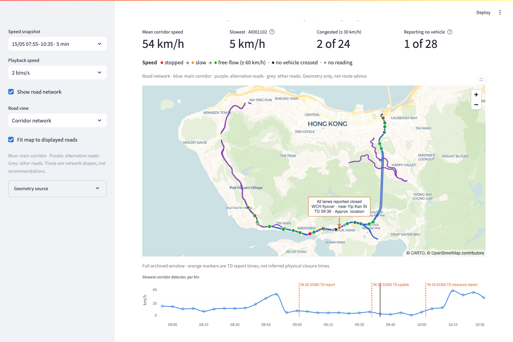

# Observed incident playback

The console shows archived TD messages beside recorded detector conditions.
An optional SUMO road overlay retains the detailed street basemap. The small
incident callout points to an approximate reported area and follows the map
when panning or zooming. This supports the agreed observed-playback demo while
the team reviews the simulation comparison.



## Run locally

Install `requirements.txt`. Supply recorded detector exports in `data/`, or
set `RIPPLE_DATA_DIR` to the directory containing them and `detectors.csv`.
The selected May incident's bilingual archive is committed as
`data/demo_incident_messages.jsonl`; include it in an alternate data directory.

```bash
python -m src.loaders.fetch detectors --start 2026-05-15T07:55 --end 2026-05-15T10:35
python -m src.loaders.fetch incidents --start 2026-05-15 --end 2026-05-15
RIPPLE_SUMO_NETWORK=/absolute/path/to/network.net.xml streamlit run src/console/app.py
```

Use the full five-minute export, not the filtered `_cov40.csv` calibration
subset. The network is optional: without it, detector playback and the full
source card still work. Road controls offer corridor, single-road and full
network views. [Geometry details](../src/console/ROAD_GEOMETRY.md) describe
projection, actual junction curves and the limits of visual alignment.

## Report timing

- The cursor is the bin start in Hong Kong time. A five-minute detector bin
  summarizes captured samples; it is not a continuous observation.
- Messages appear only once their TD publication timestamp is reached.
  Rewinding restores earlier prose, including the state before any report.
- The chart is a retrospective overview of the full selected window. Its
  orange markers are TD report/update/clearance-report times.
- Clearance comes from the loader's incident CSV. The console marks older
  closure prose as historical once the clearance report has been reached.
  An old message's `CLOSED` status alone does not establish clearance timing.
- Source prose is archived TD text, not a new Incident Reader inference.
  Publication time does not establish the physical closure time or prove when
  an operator received the message. Archive snapshot time remains available
  in the source expander.

## Approximate incident position

The callout locator supports the selected May report naming the Wong Chuk Hang
Road flyover towards Aberdeen Tunnel near Yip Kan Street. It projects the
landmark road's source vertices onto the eastbound flyover geometry and labels
the resulting position **Approx. location**. If the named shapes are missing
or too far apart, it withholds the location. No detector is substituted as the
crash coordinate. This is a display approximation, not a surveyed position or
an accepted simulation closure mapping.

The screenshot uses a provisional local OSM/SUMO network with SHA-256
`7e06875692a421d50df2fbb861abfd9435b7639093d1437ad4522d4d9a6d3c2a`.
It is not a newly approved canonical network. Geometry identity alone does not
bind a route or FCD file to an evaluated run.

The map callout shows a short report summary and time; hover for bilingual
source text or scroll to the full source card. Before the first message there
is no incident pin. Clearance changes the callout and arrow to blue.

## Review checks

For 15 May, inspect 08:50 (no published report), 09:05 (09:01 partial-lane
report), 09:40 (09:36 all-lanes update), and 10:05 (10:02 clearance report,
when the incident CSV is present). Rewind and check that future prose and
clearance do not remain visible. Zoom/pan and check that the arrow stays on the
same reported area. Missing and malformed optional networks must leave the
recorded playback usable.

Recommended-route highlighting, evaluated-vehicle animation and benefit claims
still require one jointly reviewed run bundle. The existing comparison and
approval gates remain in force. No shared JSON contract is changed.

Owner: Visuals (G and video). The silent rough cut remains a separate local
review artifact; narration and final export follow the Lead's scope decision.
Retain Transport Department / DATA.GOV.HK and OpenStreetMap / CARTO attribution.
