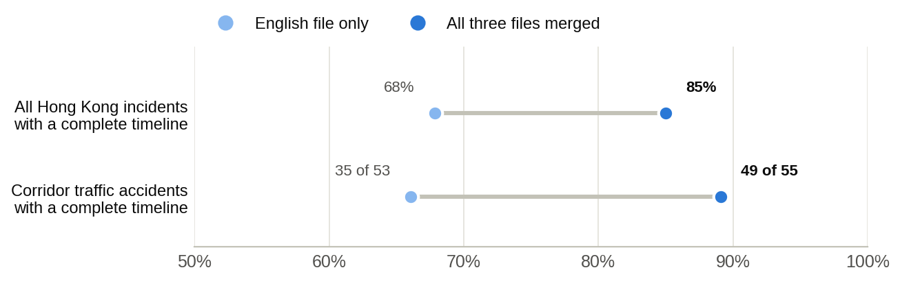
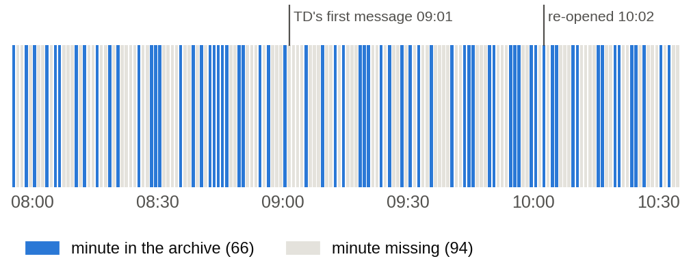
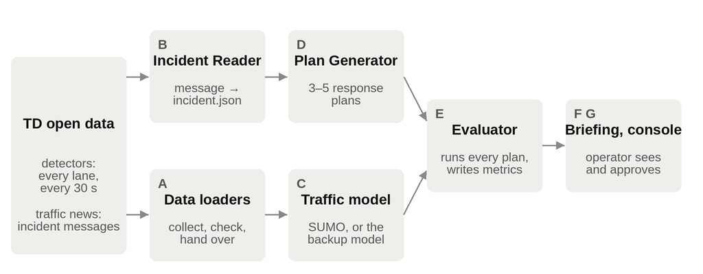
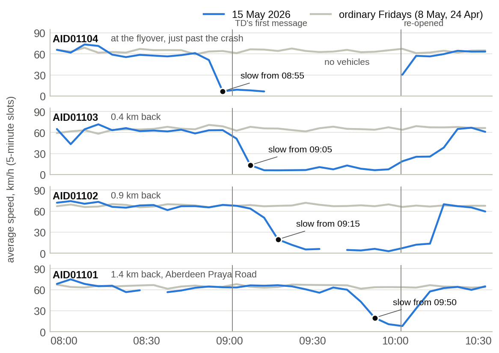
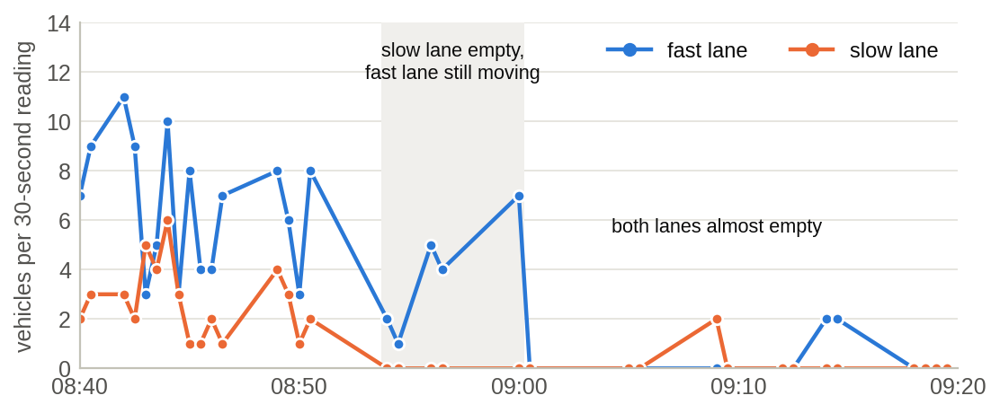
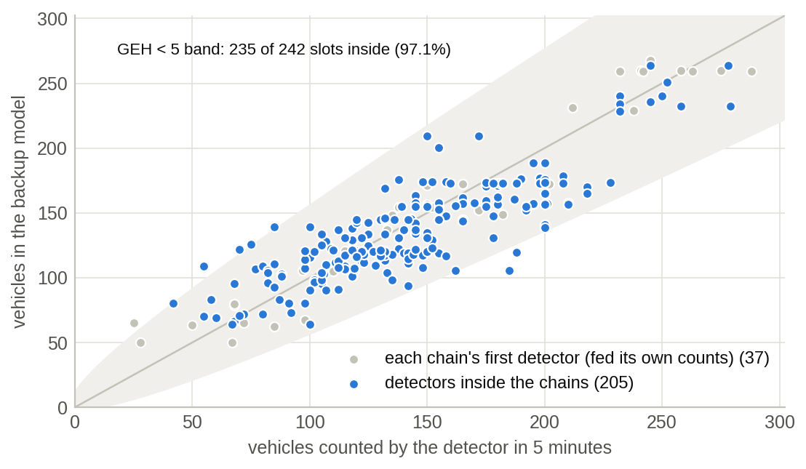
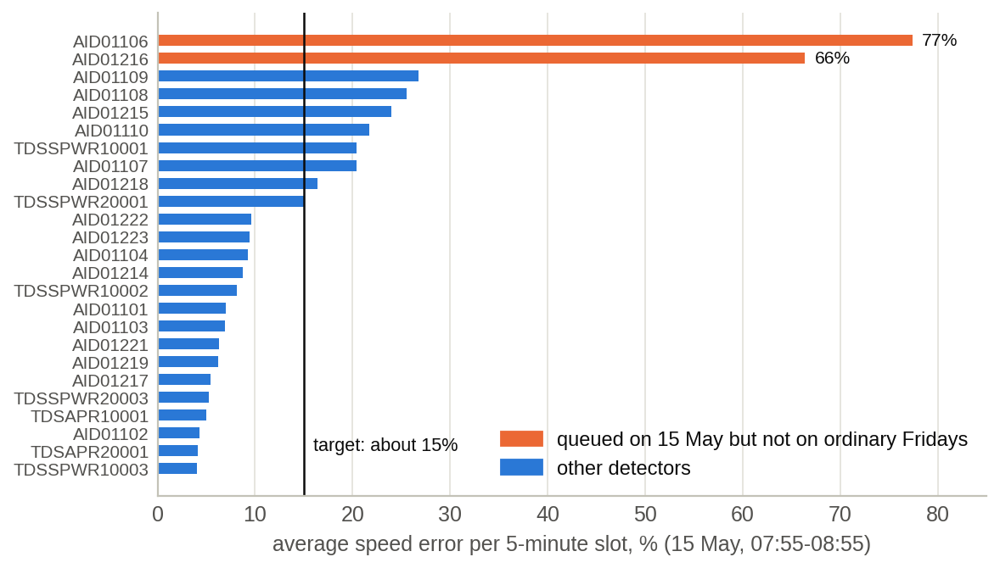
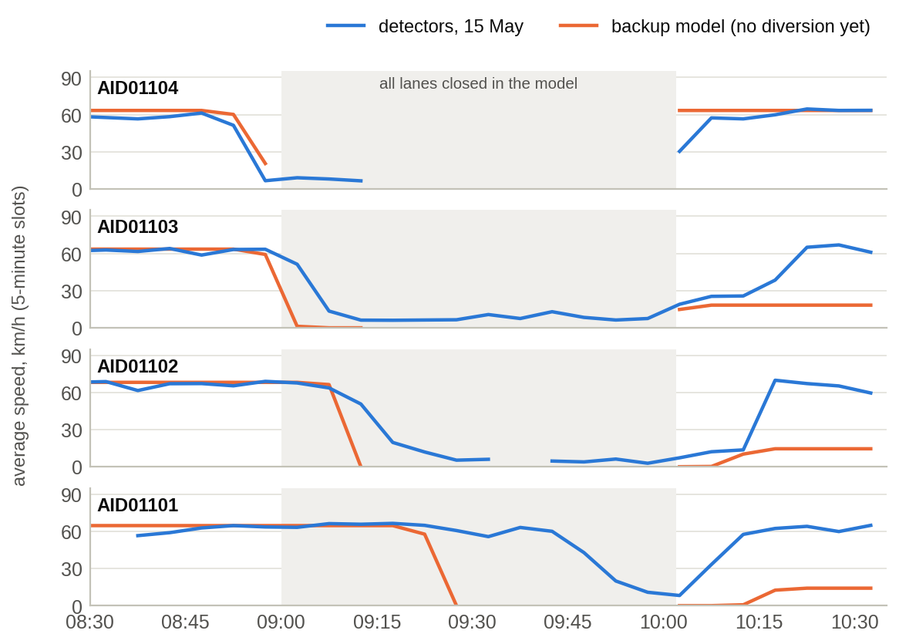
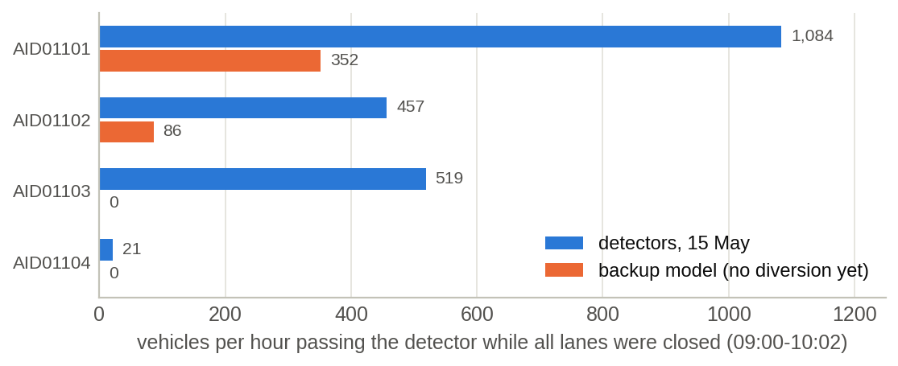

# Data and Evaluation

> Data role contribution to the interim report (components A and E), 2 October 2026. A condensed version is in [interim-report.md](interim-report.md) §§2–3.

## 1. Summary

Ripple runs on free, public data from the Transport Department (TD): readings from 28 road detectors on the Aberdeen corridor and TD's Special Traffic News. We built data loaders that collect and check this data and pass it to every other part of the system.

However, TD's public archives of past data have gaps. To make each incident's timeline more complete, we merged TD's three news files (English, Traditional Chinese and Simplified Chinese), which raised the share of incidents with a complete timeline from 68% to 85%. The detector archive also misses some minutes, but our checks show that these gaps are scattered at random, so they slightly reduce precision without skewing the results. In live use, Ripple reads TD's live feed, which has no such gaps.

With the data checked, we then chose a real incident for the demo: a crash on the Wong Chuk Hang Road flyover on 15 May 2026, selected from 35 screened corridor accidents. Lane-by-lane detector readings show one lane empty from 08:54 and almost no traffic passing from 09:00, about 35 minutes before TD reported that all lanes were closed.

To test response plans on this incident, we also built a simpler traffic model of the corridor as a backup for the main SUMO simulation. Before the crash, 97.1% of its 5-minute vehicle counts fall within the standard tolerance (target 85%). Its speed error, 16.6%, is the same as the error of simply assuming the day was an ordinary Friday, so the model adds no error of its own. This backup means the team can still test and demonstrate its plans if the main simulation is not ready in time.

Building on this model, the next step in week 3 is the evaluator, which runs every response plan through the chosen model and reports delay and queue length. This is the step that checks whether the plans Ripple suggests would actually help, so it is central to the whole system.

## 2. Data Source

All the data comes from two official feeds published by the Hong Kong Transport Department on DATA.GOV.HK:

- **Traffic detectors.** 28 detectors along the Aberdeen corridor (16 with two lanes, 11 with three and 1 with four) measure every lane separately every 30 seconds: how many vehicles passed, their average speed, and the occupancy, meaning the share of time a vehicle was over the sensor. They form four chains, one for each direction of two routes. The main road runs along Aberdeen Praya Road, the Wong Chuk Hang Road flyover, the Aberdeen Tunnel and the Wong Nai Chung Gap and Canal Road flyovers. The western alternative runs through Pok Fu Lam Road, Shek Pai Wan Road and Aberdeen Praya Road.

- **Special Traffic News.** TD's official incident messages, in English, Traditional Chinese and Simplified Chinese. Each gives the road, direction, the nearest landmark and which lanes are closed, with updates until the road re-opens.

In addition, each feed comes in two forms: a historical archive, which we use to replay past incidents, and a live feed, which Ripple reads during an ongoing incident before proposing plans. Before either form can be relied on, however, it has to be checked, as the next section explains.

## 3. Reliability of the Data and Actions Taken

Like most public data, TD's feeds are not always complete or clean. We therefore examined the raw data before using it, fixed what could be fixed, and made the rest harmless. Four findings matter, and each one is described below together with the action we took.

### 3.1 Merging the three news files

The first finding concerns the incident messages. The news archive stores the English, Traditional Chinese and Simplified Chinese files separately and saves each one at different moments, so each file misses messages that the others caught. We merge all three by message ID, with rules for the feed's quirks. For example, a stale copy that still says “updated” never re-opens an incident that TD has already closed. Incidents with a complete timeline, from the first report to the re-opening, rose from 68% to 85%, and complete corridor accidents from 35 of 53 to 49 of 55 (Figure 1).

**Figure 1**. Merging the three news files, measured over 22 March–21 September 2026 (docs/02-data.md §2). Merging also finds more incidents, which is why the corridor total rises from 53 to 55.

### 3.2 Gaps in the detector archive

While the news files could be repaired by merging them, the detector archive has a different problem: some data is simply missing. The archive should hold one detector file for every minute, and each file should contain two 30-second readings. In practice, some minutes are never listed, and many listed files can never be downloaded. On the demo morning (15 May, 07:55 to 10:35), the archive listed 113 files for 160 minutes and served 80 of them, which together cover **66 of the 160 minutes** (Figure 2).

**Figure 2**. Which minutes of the demo morning survive in TD's archive. The gaps are scattered across the morning, not bunched around the incident.

Although this may look like a large loss, it does not weaken our results. Firstly, a missing minute is never counted as an empty road. Traffic flow is worked out lane by lane from the seconds that were actually recorded, and every 5-minute slot carries a coverage figure, so a lane that did not report leaves the total unknown rather than smaller. Secondly, only well-measured slots are compared. A slot is used only when at least 2 of its 5 minutes and 90% of its lane readings are valid. This still leaves **242 of the 336 slots** before the crash, which is enough for a fair test, and it is the same set that the SUMO simulation is scored against.

Thirdly, and most importantly for accuracy, the gaps do not bias the results. Slots with fewer minutes and slots with more minutes differ by only **0.2 km/h** in average speed (54.9 against 54.7 km/h). This shows that the missing minutes are scattered at random and are unrelated to the traffic itself. They therefore make a replay slightly less precise, but not wrong.

Beyond these three safeguards, it is worth stressing that **the gaps belong to the archive, not to Ripple.** The live feed publishes every minute, and our live recorder has captured every one whenever it ran. When Ripple is used on a real incident, it reads this complete live feed.

### 3.3 Speeds reported when no vehicle passes

Apart from missing data, some readings that do arrive can be misleading. In a 30-second reading with no vehicle, the feed reports the road's speed limit as the speed (about 19% of all lane readings on 21 September) and often −1 as the occupancy. Taken at face value, an empty road would look like free-flowing traffic. Our loader recognises these readings and records them as “no speed measured” with 0% occupancy, so this quirk is removed before any other part of the system sees the data.

### 3.4 Detectors that sent no data

A related issue is detectors that send no data at all. On 15 May, three detectors (AID01105, AID01220 and TDSSPWR20002) sent nothing all morning. Instead of guessing their values, the loader reports them as missing, so no model is ever scored against readings that do not exist. Where a missing detector would be needed, the stretch on either side is joined into one and the neighbouring detector is used instead, so the corridor is still modelled along its full length. With these four issues handled, the data is ready to be passed to the rest of the system.

## 4. How the Data Flows Through Ripple

Once the data has been checked, it flows through Ripple's pipeline. Ripple is an AI co-pilot for Hong Kong traffic operators. When TD announces a road incident, Ripple reads the message, proposes a few response plans, tests each plan in a traffic model of the affected roads, and then briefs the operator, who makes the final decision.

Within this process, two streams of work run side by side and meet at the evaluator (Figure 3). The incident message is read by a language model, which turns it into a structured record and drafts 3 to 5 response plans. At the same time, the detector data checked by the loaders is used to calibrate the traffic model and to describe current traffic. The traffic model then computes what happens next: how fast the queue grows and how far back it reaches. The evaluator re-runs the simulation once for each plan, such as diverting traffic or changing signals, and once with no action, so the plans can be compared fairly. One rule runs through the whole system: **the language model never produces a number.** Every figure comes from data or a traffic model and can be traced to a file.

**Figure 3**. Ripple's pipeline

### 4.1 What the loaders hand over

Of these two streams, the data loaders feed the second. For the traffic model, they provide one row per detector for every 5-minute slot, with flow, speed and occupancy. Unusable counts are marked rather than dropped, so every other component can see exactly what was measured. Beyond this, the loaders measured two things that any traffic model of the corridor needs.

The first is where traffic joins and leaves the main road. Between two neighbouring detectors, a change in hourly flow shows side roads adding or taking away traffic. A change is accepted as real only when it is larger than the counting noise on all three Fridays studied (15 May before the crash, 8 May and 24 April). The second is how fast drivers go on a quiet road. In light traffic (occupancy of 10% or less), the median driver is faster than 60 km/h at **14 of 25 detectors**.

These two findings have already proved useful, as they explain most of the gap in the first SUMO test on 27 September. 57 of its 81 count misses sat at six detectors, five of them just after a side road joins, and every simulated car had been capped at 60 km/h. We shared these findings within the team as suggestions for the SUMO model, so the data is already helping the main model improve.

## 5. Choosing the Demo Incident

With the pipeline in place, the next task was to choose a real incident on which to demonstrate and test it. The demo needs one incident that the detectors clearly recorded. We screened every corridor traffic accident between 22 March and 21 September 2026 whose first report and re-opening were 20 minutes to 4 hours apart, which gave **35 incidents**. Each incident was compared with two ordinary days: the same weekday and clock time 1 to 6 weeks earlier, with no corridor incident and no public holiday. A detector counts as evidence only when it ran at least 20 km/h slower than the ordinary days for 10 minutes or more, which is longer than the two ordinary days ever differed from each other.

Beyond selecting a demo, the screen also shows why Ripple is needed. The corridor had **55 traffic accidents in 26 weeks, about two every week**. In addition, TD's messages trail its own sensors: for the three incidents with prepared replays, the detectors showed the disruption **6, 6 and 13 minutes** before TD's first message.

While checking the screen, we found and fixed two errors: public holidays had been accepted as ordinary days, and ordinary days before the screen's start date had not been checked for incidents. The demo incident was re-checked under the corrected rules, and the choice did not change.

After these corrections, we drew up a shortlist of five candidates and chose **IN-26-03365**, a crash on the Wong Chuk Hang Road flyover towards the Aberdeen Tunnel on Friday 15 May 2026. It had the highest score of all 35 incidents (4.38), and IN-26-06391 is kept as the backup. As Figure 4 shows, the queue can be seen growing backwards from the crash, detector by detector. While the road was shut, over 1,000 vehicles an hour kept arriving at the back of the queue, and traffic did not return to normal until about 10:15.

**Figure 4**. The crash on 15 May as seen by the detector at the flyover and the three behind it (blue), against two ordinary Fridays (gray). The queue reached AID01104 at 08:55, AID01103 at 09:05, AID01102 at 09:15 and AID01101 at 09:50. Where a line breaks, no vehicle passed, so no speed exists.

### 5.1 Which lane closed, and when

Once the incident was chosen, we needed to know exactly how it unfolded. TD's first message, at 09:01, says only that “part of the lanes” is closed. This is common: **25 of the 35 screened accidents** had such a phase, and only 7 named the lane. A traffic model, however, has to close a specific lane.

Fortunately, the detectors can often answer this question, because they measure each lane separately. At AID01104, just past the crash, **the slow lane carried no vehicle in five readings in a row, from 08:54:00 to 09:00:00, while the fast lane kept moving** (Figure 5). On the two ordinary Fridays, this happened in only 1 reading out of 30. From 09:00:30, both lanes were almost empty. In other words, the road was effectively shut about 35 minutes before TD's 09:36 message reported that all lanes were closed.

**Figure 5**. Vehicles per 30-second reading in each lane of AID01104 (results/data/lane-evidence_AID01104_20260515-0840_0920.md). The lines join the readings the archive kept.

This shows that the data can do more than confirm a message: it can fill in what the message leaves out. We therefore propose closing the slow lane first in the replay, although this choice is still to be confirmed. We are also preparing a stated default for “part of the lanes” and a rule for when detector evidence may replace it. The 7 accidents where TD did name the lane give a ready-made test: run the rule without looking at TD's wording, and count how often it names the same lane.

## 6. Evaluation with the Backup Traffic Model

Before any plan can be tested, Ripple needs a traffic model that behaves like the real corridor. The project plan states that if the main simulation does not roughly match the detectors by 4 October, the team will switch to a simplified network on that day: “losing the twin is survivable; losing week 3 is not.” We built this backup so that we have a real choice at the go/no-go meeting on 4 October, and so that the evaluation can go ahead in either case.

### 6.1 How the model works

The backup model is deliberately simple. It follows each of the four detector chains, which are divided into 24 stretches from one detector to the next. Each stretch is cut into short cells. At every time step (at most 3 seconds), each cell sends on the vehicles that can leave it, and the next cell accepts as many as it has room for. When a cell ahead is full, the vehicles behind must wait, so the queue grows backwards cell by cell, just as it did on 15 May. This is the **cell transmission model** (Daganzo, 1994), a standard method for modelling queues.

Just as importantly, every input comes from a file: road lengths from the map, lanes and speeds from TD's detectors on the ordinary Fridays, and traffic joining and leaving from section 4.1. Only two values are standard textbook figures, 1,800 vehicles per hour per lane and 140 stopped vehicles per km per lane, and they are stated wherever the results appear. Vehicles are only created where traffic enters and removed where it leaves, and a test confirms that no vehicle is ever lost.

### 6.2 How well it matches the morning before the crash

To find out whether the model can be trusted, we scored it in exactly the same way as the SUMO twin: the same hour (07:55 to 08:55), the same 242 five-minute counts and the same two tests. The first test is the GEH statistic, which traffic modellers use to judge whether a modelled count is close to the real one; a GEH below 5 is the standard pass. The second is the average speed error per 5-minute slot.

**Table 1**. Scores before the crash (results/fallback/replay_20260515.md).

| **Scored on**                             | **Counts with GEH \< 5** | **Speed error** | **Speed error if you assume an ordinary Friday** |
|-------------------------------------------|--------------------------|-----------------|--------------------------------------------------|
| Backup model, all detectors               | **97.1%** of 242         | 16.6%           | 16.6%                                            |
| Backup model, detectors inside the chains | **97.1%** of 205         | 17.8%           | 17.8%                                            |
| SUMO twin, 27 September test              | 66.5% of 242             | 36.9%           | –                                                |
| Target (docs/03-architecture.md §4)       | at least 85%             | about 15%       | –                                                |

As Table 1 shows, the counts pass the target by a wide margin. Even when the four detectors that feed each chain are left out, **199 of 205 counts (97.1%)** still pass (Figure 6). Everything else in the model comes from the ordinary Fridays, not from 15 May.

**Figure 6**. Every 5-minute count before the crash: detectors against the backup model. Points inside the shaded band pass the GEH \< 5 test.

At first sight, the speed error of 16.6% misses the target of about 15%. However, the number has to be read against a fair baseline. If every 5-minute speed on 15 May is predicted with the ordinary Fridays' average at the same detector, the error is also 16.6%. In other words, **the model adds no error of its own**; the remaining error is simply how 15 May differed from an ordinary Friday. Two detectors that queued that morning, but not on the ordinary days, carry most of it (Figure 7). Without them, the error inside the chains falls to **12.1%**, well within the target.

**Figure 7**. Average speed error per detector before the crash. AID01106 ran at 8–19 km/h from 08:00 to 08:40 against an ordinary 24 km/h; AID01216 ran at about 15 km/h until 08:10, then 51–80 km/h, against an ordinary 28 km/h.

### 6.3 Replaying the incident

Having confirmed that the model matches normal traffic, we then closed the flyover as the detectors saw it and compared the result with the real morning (Table 2 and Figure 8). This timing follows the detector evidence and is still to be confirmed; an alternative timing closes all lanes only at TD's 09:36 update. Both versions will be run on 4 October, so the detectors can show which one matches better.

**Table 2**. When the queue reached and cleared each detector: real detectors against the backup model.

| **Detector**            | **Queue reached it: detectors** | **Queue reached it: model** | **Cleared: detectors** | **Cleared: model** |
|-------------------------|---------------------------------|-----------------------------|------------------------|--------------------|
| AID01104 (at the crash) | 08:55                           | 08:55                       | 10:00                  | 10:00              |
| AID01103                | 09:05                           | 09:00                       | 10:15                  | not by 10:35       |
| AID01102                | 09:15                           | 09:10                       | 10:15                  | not by 10:35       |
| AID01101                | 09:50                           | 09:25                       | 10:05                  | not by 10:35       |

Comparing the two shows a clear pattern. The model gets the start of the incident right: the queue arrives within 5 minutes of the real time at the three detectors nearest the crash. Later, it lets the queue run too far and for too long, reaching AID01101 25 minutes early and not clearing by 10:35.

**Figure 8**. Speeds at the four detectors nearest the crash: detectors (blue) and backup model (orange). Where a line stops, no vehicle passed that detector in that slot.

The reason for this difference can be found in the detectors themselves (Figure 9). While all lanes were closed, they kept counting traffic that the model holds still. At AID01103, 519 vehicles an hour left by the slip road before the flyover. Between AID01101 and AID01102, about 540 vehicles passed AID01101 but only about 180 crept past AID01102, and the 556 m between them holds only about 230 stopped vehicles. So **at least about 130 drivers left the road in between**. In reality, drivers diverted on their own; in the model, nobody turns off yet.

**Figure 9**. Traffic still passing each detector while all lanes were closed: the drivers who took other roads.

### 6.4 Why these gaps do not hold the project back

Although the replay is not yet perfect, these gaps do not hold the project back. First, the missing piece is already planned. Diverting traffic is exactly what Ripple's response plans do, so diversion is being added to the model in week 3 anyway, and Figure 9 already gives the yardstick to check it against. Second, the current results are on the safe side. Without diversion, the model's queues and delays are upper bounds, so it does not understate how serious an incident is. Third, the start of the incident is already correct, and this is the part that matters most to an operator who must decide what to do in the first few minutes.

It is also important to remember how the model is used. Ripple does not make a one-off forecast; it compares plans with each other. Every plan is tested on the same morning with the same model, so an error that all plans share has much less effect on which plan comes out best. The model is also fast: the whole morning, on all four chains, runs in about 35 seconds on a laptop, so every plan can be tested under many different assumptions.

## 7. The Evaluator: Next Step

With a working model in hand, we can now turn to the evaluator, the final component of the pipeline, which will be built in week 3 (5 to 11 October). It runs every response plan, together with a do-nothing case, through the chosen model on the same morning, and writes one result file per run. Each result reports the total delay in vehicle-hours and its change against doing nothing, the longest queue, the travel time along the corridor, CO₂ and the other agreed measures. Some of these, such as CO₂, still need to be added to the backup model.

To make sure a recommendation is not a lucky result, each plan is repeated for 30%, 50% and 70% of drivers following the advice, and for several clearance times. Every result also states which lane was closed, why, and the timing assumed. **The plan results have not been measured yet.** Table 3 shows how this work fits into the remaining schedule.

**Table 3**. Milestones until submission.

| **When**          | **Milestone**                | **Our work**                                                                                                  |
|-------------------|------------------------------|---------------------------------------------------------------------------------------------------------------|
| Sat 3 Oct         | Interim report               | This contribution                                                                                             |
| Sun 4 Oct         | Go/no-go on the simulation   | Backup model results, plus a run with the alternative incident timing so the two can be compared              |
| 5–11 Oct (week 3) | Plans and results            | The evaluator; diversion in the backup model; the lane rule tested on the 7 accidents where TD named the lane |
| Wed 14 Oct        | Results freeze               | Every result regenerated from one command; numbers locked                                                     |
| Sat 17 Oct        | Deck and prototype submitted | Every figure in the deck traceable to a results file                                                          |

### 7.1 How we will judge success

To judge whether this work succeeds, we will track the measures in Table 4, which also show where we stand today.

**Table 4**. Success measures for the data and evaluation work.

| **What**               | **Measure**                                                                                          | **Target**                                   | **Now**                  |
|------------------------|------------------------------------------------------------------------------------------------------|----------------------------------------------|--------------------------|
| Baseline counts        | 5-minute counts with GEH \< 5, 07:55–08:55                                                           | at least 85%                                 | **97.1%** (backup model) |
| Baseline speeds        | Average speed error per 5-minute slot                                                                | about 15%, shown with the ordinary-day floor | 16.6% (floor 16.6%)      |
| Incident timing        | When the queue reaches each detector                                                                 | within 5 minutes                             | 3 of 4 detectors         |
| Traffic that turns off | Flow while all lanes are closed, model against detectors (Figure 9)                                  | close at every detector                      | not yet (no diversion)   |
| Lane rule              | Same lane as TD on the 7 accidents where TD named it                                                 | agreement rate reported                      | not measured yet         |
| Plan comparison        | The best plan still wins at 30%, 50% and 70% of drivers following advice, and across clearance times | holds across the range                       | not measured yet         |

## 8. How We Checked the Work

Since every number in Ripple must be trustworthy, we test our work in three ways: against reality (section 6), against itself, and independently. The data layer and the backup model are covered by **228 automated tests** (339 in the whole repository, all passing), and some of these are edge cases written specifically to find problems rather than only to confirm fixes. One of these tests checks that the model never loses a vehicle: in every run, the vehicles that entered must equal those that left, plus those still on the road, plus those waiting to enter.

In addition, to make sure the backup model's score is not the result of a hidden error, it was recomputed from the raw detector readings with separately written code, and the two results matched exactly: the same 242 slots, 97.1% and 16.6%. Finally, every table and figure in the results folder is regenerated by a single command, so anyone in the team, or any judge, can reproduce our numbers.

## 9. Limits of the Data and Why Ripple Remains Sound

Despite these checks, no public data set is perfect, and we prefer to state the limits of ours plainly. Table 5 lists each limit, what it affects, and why it does not prevent Ripple from doing its job.

**Table 5**. Known limits of the data and how each one is handled.

| **Limit**                                           | **What it affects**                           | **Why Ripple is still sound**                                                                                                                                             |
|-----------------------------------------------------|-----------------------------------------------|---------------------------------------------------------------------------------------------------------------------------------------------------------------------------|
| The archive keeps under half of the minutes         | How precisely a past morning can be replayed  | The gaps are random (only 0.2 km/h difference), 242 usable slots remain, and live use reads the complete live feed                                                        |
| The feed reports the speed limit when no car passes | Empty roads would look like fast traffic      | Detected and corrected in the loader before any other component uses the data                                                                                             |
| Some detectors send no data (3 on 15 May)           | Fewer points to compare with                  | Reported as missing, never guessed; neighbouring stretches are joined                                                                                                     |
| TD's messages are late and vague about lanes        | Which lane to close in the model, and when    | Lane-by-lane detector readings fill the gap; the rule will be tested on the 7 accidents where TD named the lane                                                           |
| Speed error of 16.6% against a target of about 15%  | How the speed score looks                     | It equals the ordinary-day floor, so the model adds no error; it falls to 12.1% without two unusual detectors                                                             |
| No diversion yet in the backup model                | Queue length and clearance time in the replay | Results are upper bounds; diversion is added in week 3 and checked against Figure 9                                                                                       |
| Capacity and jam density are textbook values        | The exact length of a queue                   | Standard values, stated openly, and the same for every plan, so the ranking of plans stays fair                                                                           |
| One corridor only                                   | How widely the results apply                  | The corridor has about two accidents a week; the method uses only feeds TD already publishes, so it can be applied to other corridors with detectors without new hardware |

Taken together, these limits affect how precisely a past morning can be replayed, but not whether Ripple can do its job. Every limit is known, measured and handled in a stated way, every number can be traced to a file, and the live system reads a complete feed. We are therefore confident that the data is a sound foundation for the evaluation in week 3 and for the final demo.

## 10. Responsible Use of Data

Finally, using public data responsibly matters as much as using it accurately. Ripple handles no personal data. The detector feed reports only counts, speeds and occupancy for each lane, with no images or number plates, and the traffic news is a public announcement. The data is also free to use: DATA.GOV.HK allows both commercial and non-commercial use, provided the source is acknowledged, so we will credit TD and DATA.GOV.HK wherever the data is shown. Because the data is supplied “as is”, without any warranty, we check it ourselves before using it, as described in section 3.

We are also careful about the limits of generative AI. No number in this report comes from a language model. The data layer and the traffic models are ordinary, repeatable code, and the lane evidence allows code, rather than the language model, to fill in what a message leaves out. Where the data cannot help, we say so openly, for example when an incident happens far from any detector, when a detector is offline, or when a closure empties every lane at once. Finally, Ripple is easy to adopt. It needs no new sensors or hardware, it runs on feeds that TD already publishes, and the backup model replays a whole morning in about 35 seconds on an ordinary laptop.
