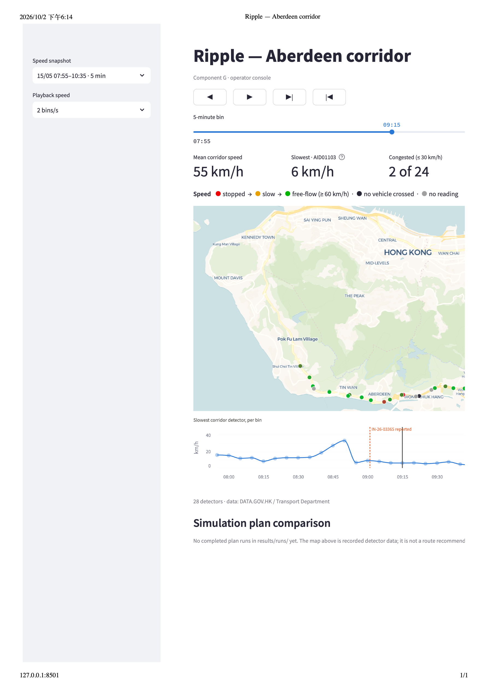

# Interim Report Working Draft — Project Ripple

> **Internal submission target:** Saturday 3 October 2026
>
> **Official deadline:** Sunday 4 October 2026

Impact coordinates and assembles the report. This 3 October revision integrates
the available component evidence and drafts the remaining narrative sections.
It remains a working draft awaiting Lead and Impact review, uploader confirmation
and a submission receipt. No accepted end-to-end plan benefit has been measured.

**Reminder to all owners:** add your paragraph with evidence links and remaining
limitations, and flag missing inputs to Impact promptly. Do not wait for a
successful simulation to report current progress and blockers. Impact should
confirm a collection cutoff that leaves time for Lead review before the internal
submission target on Saturday 3 October. No collection cutoff is agreed yet.

### Contribution checklist — 3 October

- [x] Lead: Reader results, architecture and D/F progress drafted in §2; final review pending.
- [x] Data: evidence-based ingestion summary in §2 and evaluator status in §3; owner review pending.
- [x] Simulation: calibration evidence and unmet targets integrated in §3.
- [x] Visuals: console progress and supported screenshot integrated in §4.
- [x] Sections 1 and 5: narrative drafted from repository evidence; Impact review pending.
- [ ] Lead + Impact: review the complete draft, confirm who uploads it, and record submission confirmation.

## 1. Executive Summary & Social Problem

- **Owner:** Impact

Ripple is a prototype incident co-pilot for traffic operators on Hong Kong's
Aberdeen corridor. It combines public detector observations and bilingual
incident messages with a planned comparison of response options. The intended
benefit is to help an operator assess whether a diversion reduces total delay
without transferring excessive disruption to neighbouring streets. This is a
hypothesis to test, not a demonstrated outcome or a replacement for existing
traffic-management operations.

The prototype now includes data ingestion, an evaluated Incident Reader,
observed-data console playback, and initial plan-generation and briefing
components. The principal remaining dependency is an accepted traffic baseline
and comparable evaluator outputs. No validated reduction in delay, emissions
or emergency travel time is available at this checkpoint. Aberdeen provides a
bounded demonstration corridor with public detector coverage; the project
excludes city-wide control and a consumer navigation application
([scope](00-brief.md), [architecture](03-architecture.md)).

The evaluation will distinguish observed traffic, an incident simulation with
no intervention, and simulations with response plans. Observations assess model
credibility; plan-versus-baseline comparisons assess potential benefit. The
4 October model decision and 14 October results freeze protect time for this
evaluation and the final demonstration ([schedule](04-plan.md)).

## 2. Data, Incident Reader & System Architecture

- **Owner:** Lead; Data contributes the data-ingestion paragraph.
- **Starting sources:** `docs/02-data.md`, `docs/03-architecture.md` §1, and `docs/00-brief.md` §4.
- Describe the data feeds and their limits (A, Data), incident parsing (B, Lead), candidate plans and validation (D, Lead), briefing (F, Lead), and how a human operator approves advice.
- Show the pipeline and contracts without implying that the LLM computes simulation metrics.

### Lead contribution — 30 September 2026

Ripple uses a modular pipeline: archived bilingual Transport Department Special
Traffic News enters the Incident Reader, which extracts incident details into a
validated JSON record. Code copies identifiers, timestamps and source text;
the language model extracts road, direction, landmark, incident type and lane
wording. It preserves missing information, including `unspecified` when TD
does not identify the closed lanes. All model calls are logged, and invalid
responses are retried once before being flagged for review.

The Reader was evaluated on 100 manually labelled archived messages: 80 in
the citywide sample and 20 on the corridor. In v1, all scored fields were
correct for **50% of citywide messages and 75% of corridor messages**. After
a direction-format prompt correction and four label corrections made after
the initial results had been seen, v2 scored **75% and 85%**, respectively.
The v2 figures are development results, not a new held-out evaluation. Against
the unchanged v1 labels, v2 scored 59/80 citywide and 16/20 corridor. Remaining
errors include unsupported lane totals, road junctions and inferred landmarks.
The [score history](../data/labelled_incidents/LABELLING.md#score-history)
records the label-review chronology and limitations; the scored artifacts are
[v1](../results/reader/2026-09-25T0026_qwen3-8b_score.json),
[v2](../results/reader/2026-09-25T0048_qwen3-8b_score.json) and
[v2 against v1 labels](../results/reader/2026-09-25T0048_qwen3-8b_score_labels-v1.json).

For the selected incident, IN-26-03365, the Reader was also checked on TD's
actual 09:01 and 09:36 messages. The structured core fields matched the source:
the first message produced `["unspecified"]`, and the escalation produced
`["all"]`. One free-text `notes` sentence incorrectly described a direction
bracket; this remains a known defect. This two-message check demonstrates the
selected handoff, rather than additional accuracy evidence
([source messages](../data/demo_incident_messages.jsonl),
[Reader output](../results/reader/2026-09-29T1608_qwen3-8b.jsonl)).

The planned downstream flow is candidate plans → code-based constraint checks
→ simulation of each plan → an operator briefing grounded in saved simulator
results. P0 (no intervention), P1 (a single broadcast detour) and a coordinated
P2 are required for comparison. The Plan Generator and Briefing Writer are
implemented as an initial command-line path against the existing contracts,
with offline tests using mocked model responses. Real-model quality, evaluated
plan benefits and an accepted full incident baseline are not yet available
([handoff and limitations](lead-pipeline-handoff.md)). Human approval is
required before any advice is published or acted upon.

Three unresolved modelling details remain explicit: Simulation proposes an
08:55 physical onset based on observed queue development; TD's first report
arrived at 09:01; and Data/E still owns the initial lane choice for
`unspecified`. These are distinct from the pre-incident calibration problem.
The Reader does not resolve them by guessing a lane or changing the source
timestamp. These retrospective onset and lane choices remain hypotheses until
the scenario owners agree and document them.

### Data contribution — evidence synthesis, 3 October 2026

The loaders ingest public Transport Department detector readings and archived
Special Traffic News for the corridor. They preserve missing readings, exclude
zero-vehicle speed placeholders, and distinguish archive coverage from valid
lane readings. Merging the three archived news feeds improved complete incident
timelines from 68% to 85% in the documented March–September sample
([data methods and sample](02-data.md)). This describes archive reconstruction,
not incident-detection accuracy or proof that missing observations are random.

The selected incident is IN-26-03365 on 15 May; its screening was refreshed after
holiday and control-day checks changed
([refreshed incident screen](../results/data/candidates_2026-05-15.md)).
The full ranking and backup require refreshed screening before further use.
Count calibration retains bins with at least 40% archive coverage and 90% valid
lane readings. The saved [coverage diagnostic](../results/data/bin-survival_20260515-0755_1035.md)
supports sensitivity analysis, but similar average speeds across coverage groups
do not establish unbiased missingness. Low or zero flow alone cannot establish
a physical closure or its exact onset.

## 3. Simulation Evaluation & Preliminary Results

**Owner:** Simulation (Data contributes evaluator methodology and results)  
**Status:** Contribution Integrated (2 October 2026)

Component C runs a provisional SUMO model of the Aberdeen corridor using OpenStreetMap and archived Transport Department detector observations. Work completed includes left-hand conversion, direction-aware detector placement, measurement across modelled lanes, timestamp matching, pre-incident demand fitting, and corrected route departure ordering.

---

### 📊 Pre-Incident Calibration Performance

Calibration uses the selected incident's **15 May 2026, 07:55–08:55 HKT** observations after a 15-minute warm-up. Counts are scored only where archive coverage is at least 40% and at least 90% of lane readings are valid. 

The 2 October controlled comparison kept network, demand, routes, and seed fixed, changing only an unsupported 16.7 m/s vehicle speed ceiling so vehicles could follow network limits:

| Pre-incident Metric | Reference | Speed-Ceiling Removal | Target / Benchmark | Status |
| :--- | ---: | ---: | ---: | :---: |
| **Count bins with GEH < 5** (242 bins) | 66.53% | **66.94%** | At least 85.00% | ⚠️ Unmet |
| **Speed MAPE** (296 common bins) | 36.94% | **41.36%** | $\le 15.00\%$ | ⚠️ Unmet |
| **Teleports** | 68 | **53** | Review required | 🔄 Improved |
| **Vehicles waiting to enter at run end** | 2,405 | **2,390** | Review required | 🔄 Improved |

> **Key Finding:** Both runs completed all 4,500 simulation seconds without route-loading errors. Although teleports decreased (68 → 53), speed error (MAPE) worsened, meaning both calibration targets remain unmet for independent validation.

#### Reproducible Artifacts & Evidence
* 📄 **Reference Run JSON:** [`results/twin/oct02-reference.json`](https://github.com/f1ymango/ripple/blob/be7bd65/results/twin/oct02-reference.json)
* 📄 **Modified Run JSON:** [`results/twin/oct02-network-speed.json`](https://github.com/f1ymango/ripple/blob/be7bd65/results/twin/oct02-network-speed.json)
* 📊 **Paired Comparison:** [`results/twin/oct02-comparison.json`](https://github.com/f1ymango/ripple/blob/be7bd65/results/twin/oct02-comparison.json)

---

### 🔍 Source Audit & Diagnostic Findings

1. **Lane-Access Discrepancies:** Inconsistent lane-access tags were identified at a critical tunnel transition, allowing passenger cars onto a lane with no onward connection.
2. **Unresolved Scopes:** Three detector lane-count conflicts and three missing May-window lane scopes remain unresolved.
3. **Physical Queue Distortion:** Teleports and insertion queue delays directly distort travel times and plan rankings; they are treated as operational bottlenecks rather than cosmetic warnings. See full [Diagnosis and Source Audit](https://github.com/f1ymango/ripple/blob/be7bd65/docs/calibration-progress-2026-10-02.md).

---

### ⚠️ Pending Evaluation & Limitations

* **Full incident P0-versus-observed validation and P0/P1/P2 benefit comparisons are `[not measured yet]` in an accepted run.**
* **Timeline Assumptions:** Simulation proposes an 08:55 physical onset, 09:36 all-lanes phase, and 10:02 reopening (pending alignment with Data/E). TD's first public alert arrived at 09:01.
* **Fallback Strategy:** Data's simplified-network fallback remains active for the 4 October submission decision.
* 🎥 **Diagnostic Video:** [Full-horizon traffic-only diagnostic video](https://github.com/f1ymango/ripple/blob/be7bd65/results/twin/aberdeen-full-traffic-sept30.mp4) (Demonstrates flow execution with no assumed closure).

### Evaluator and model decision — 3 October 2026

Comparable P0/P1/P2 runs are still pending. Each comparison must share the
incident, network and demand inputs, compliance, clearance duration and seed,
and preserve provenance linking plans and metrics to those inputs. Sensitivity
across compliance and clearance assumptions follows the first accepted
comparison; common assumptions alone do not guarantee a reliable ranking.

The simplified fallback remains under review. Its saved replay injects a closure
at 08:54 while scoring a nominal pre-incident window ending at 08:55, so those
scores cannot establish no-closure calibration. The next model decision requires
a separate no-closure run, clearly separated demand-input and internal scoring
detectors, and comparable observation windows and filters. An ordinary-day
speed reference is a comparator, not a mathematical error floor. Incident queue
formation and recovery and diversion behaviour require separate validation
([review and evidence links](project-status-2026-10-03.md)).

## 4. Operator Console & Demo Visuals

- **Owner:** Visuals

### Visuals contribution — 2 October 2026

Component G is a Streamlit operator console for inspecting the Aberdeen
corridor and replaying an archived incident. The current console displays 28
detector locations, colours measured speeds, and shows headline speed and
congestion indicators. It distinguishes a detector reporting no vehicles from
a missing reading, so archive gaps are visible. Play/pause, step, rewind and
timeline scrubbing let an operator inspect the recorded five-minute bins,
alongside TD's report and clearance markers. Corridor framing and a shared
light theme make the map and controls readable.

*Figure 4.1. Recorded detector-data playback for IN-26-03365 at 09:15 HKT,
captured from the local console on 2 October 2026. The plan-comparison panel
reports that completed simulation runs are still pending.
This screenshot documents the current console; it provides no evidence of
simulated rerouting or a measured plan benefit. Data: DATA.GOV.HK / Hong Kong
Transport Department. Basemap: CARTO / OpenStreetMap contributors. The capture
has a clipped right edge.*

[Original console PDF export](img/interim-console-2026-10-02.pdf).

| Feature | Status at the interim checkpoint |
|---|---|
| Detector map, speed indicators, incident timeline and playback controls | Implemented in the console. |
| Corridor framing and light theme | Implemented in the console. |
| P0/P1/coordinated-plan comparison and recommendation | Proposed workflow under review in PR #41; not integrated into the accepted console. |
| Paired simulation replay | Proposed renderer under review. Real trajectories must be bound to the evaluated simulation inputs; file hashes alone do not establish this relationship. |
| Operator approval and audit logging | Proposed implementation under review; Windows startup and audit locking require correction and testing. |
| Briefing/message panel and what-if interaction | Accepted end-to-end console integration remains pending. |
| Final demo video | Pending validated simulation outputs and completion of the operator workflow. |

The focused console and recommendation checks passed all 46 tests on 2 October.
These checks verify UI behaviour and input handling; they do not establish
traffic-model accuracy or plan effectiveness. Integration still requires
reviewed road geometry and an incident edge, completed matching plan/result
files, and paired trajectories demonstrating actual rerouting. All future
plan-benefit figures will come from simulator artifacts in `results/`.

## 5. Feasibility, Sustainability, Ethics & Impact

- **Owner:** Impact

The intended user is a traffic operator evaluating options before approving
public advice. The initial feasibility test is a bounded corridor demonstration
using open aggregate detector observations and public incident notices. A
deployment budget has not been established. A future costing should separately
record network preparation and calibration effort, compute and model inference,
hosting, maintenance, operator training and integration. Potential benefits must
first be measured as plan-versus-baseline simulator outcomes. Monetary valuation
would additionally require sourced local values of time, occupancy assumptions
and explicit operating costs; no benefit-cost ratio is claimed here.

One anonymous experienced green-minibus driver was interviewed on 26 September.
The interviewer's notes describe reliance on peer verification, concern about
alternative-route conditions, and interest in clear local and bilingual wording.
These are qualitative findings from one participant, not representative driver
preferences or measured compliance. Numerical savings presented in the concept
prompt were hypothetical stimuli, not Ripple results. Further interviews should
test these themes with operators and other road users
([interview notes and limitations](../evidence/interviews/2026-09-26-minibus-driver.md)).

The constraint validator checks residential diversion shares, school-time
restrictions, blocked roads and the emergency priority corridor. Its initial
offline implementation does not establish real route suitability: reviewed
route/context inputs and simulated distributional outcomes remain prerequisites
([D/F handoff](lead-pipeline-handoff.md)). Vehicle-class restrictions need a
separate design decision. Reduced corridor delay must not conceal additional
delay on residential streets or emergency routes.

The intended operating policy requires human review before advice is acted on,
with an audit trail for operator decisions; the console implementation remains
under review. Traffic inputs are aggregate observations and public notices,
without individual vehicle tracking. Interview evidence is anonymised. Uneven
detector coverage and archive gaps limit confidence, and missing data must remain
visible. Sustainability benefits, including lower CO₂, remain evaluation goals;
they have not been demonstrated by the current prototype.

## Submission readiness — pending Lead and Impact confirmation

- [ ] Review the assembled narrative and evidence links, including the screenshot's disclosed clipped right edge.
- [ ] Confirm the required submission format and any length limits against organiser instructions.
- [ ] Confirm the uploader and final approved report version.
- [ ] Upload by the official 4 October deadline and retain the timestamp and receipt.

No uploader or submission receipt is recorded in the reviewed repository
evidence. This checklist is preparation for submission, not confirmation that
submission has occurred.
