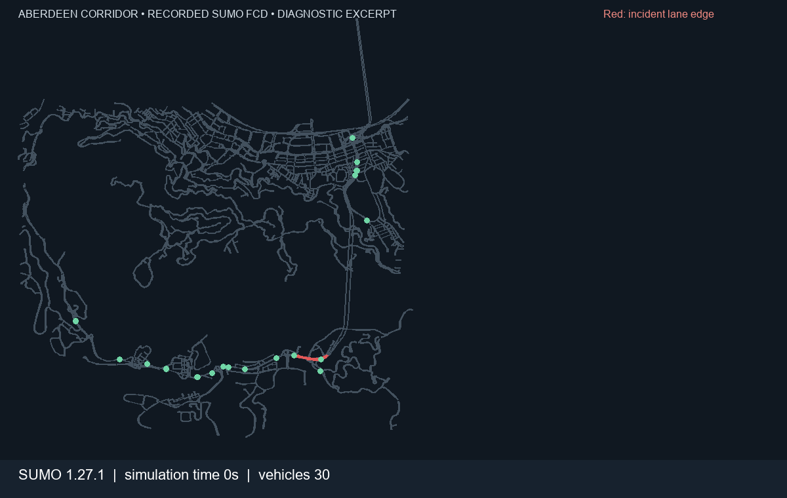

# Aberdeen SUMO diagnostic

The animated GIF renders actual vehicle positions recorded by SUMO 1.27.1 on the Aberdeen corridor network. It samples completed FCD snapshots every 60 simulation seconds and spans simulation time 0–6,360 seconds. The red segment marks the incident edge.

This is an **incomplete diagnostic excerpt**, not a validated baseline. The intended run horizon was 30,900 seconds, but the run was stopped at approximately 6,410 seconds after repeated jam and teleport warnings. The interrupted run did not produce complete E1 detector intervals: the attached partial evaluation has zero scoreable count or speed bins. Do not quote it as a calibration result. The run summary records that the exact teleport and dropped-vehicle totals were unavailable for this interrupted run; future runs record those counters and the estimated departure-delay drops.

The calibration input is [`sim/scenarios/calibration.json`](../../sim/scenarios/calibration.json), derived from the available 15-minute detector bins in the pre-incident hour. Candidate incident screening is in [`data/candidates.md`](../../data/candidates.md).
